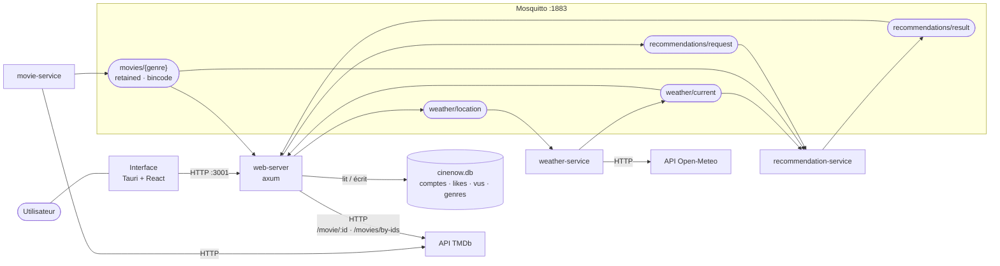
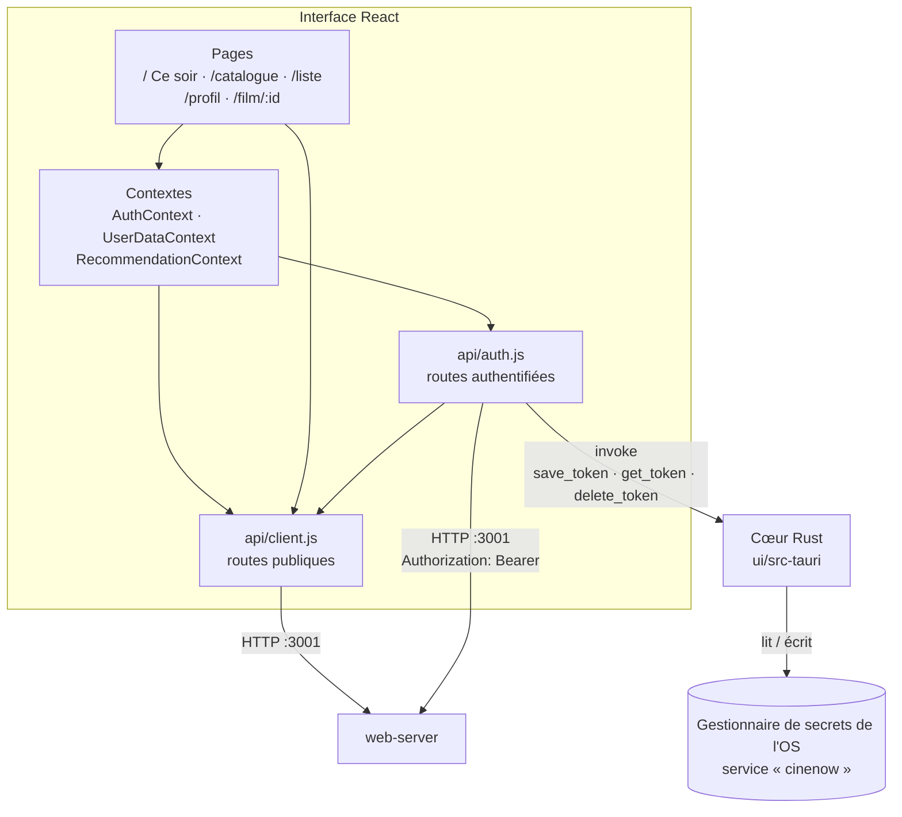
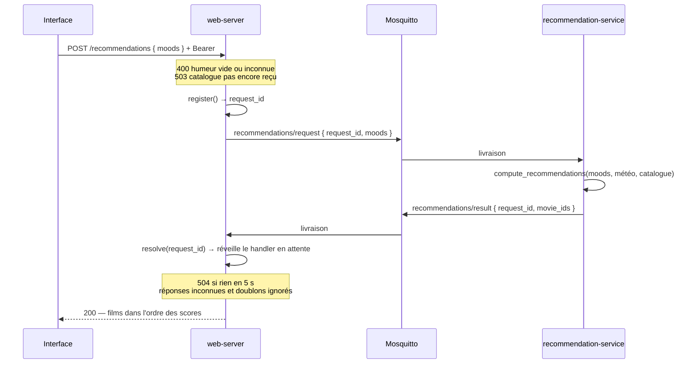

# Architecture

Quatre services Rust communiquant par **MQTT**, une base **SQLite** pour l'espace
utilisateur, et une application de bureau **Tauri + React**.

Les diagrammes sont en Mermaid : GitHub les rend directement, et ils se relisent
en diff à chaque évolution — contrairement à une image, qui se périme en silence.

---

## Vue d'ensemble

Les catalogues sont publiés en **retained** : un service qui démarre reçoit le
dernier état sans attendre la prochaine publication, ce qui rend l'ordre de
démarrage indifférent. Le broker tourne en revanche sans persistance, donc un
redémarrage du broker vide les catalogues jusqu'à la republication par
`movie-service`.

---

## L'interface

Application à page unique, routée par **hash** (`createHashRouter`) : l'app est
servie depuis un fichier local, où un historique par chemin ne retomberait pas
sur `index.html` au rechargement.

| Élément | Rôle |
|---|---|
| `AuthContext` | Session : connexion, inscription, restauration au démarrage, déconnexion |
| `UserDataContext` | Likes, films vus et genres favoris, en bascule optimiste |
| `RecommendationContext` | Humeurs choisies et résultats — vit **au-dessus du routeur**, pour survivre à l'ouverture d'une fiche film |
| `api/client.js` | Transport (`apiFetch`, `ApiError`) et routes publiques |
| `api/auth.js` | Token et routes authentifiées ; un `401` purge la session |

Le token JWT n'est **jamais** écrit en clair ni mis dans `localStorage` : il est
confié au gestionnaire de secrets natif de l'OS par trois commandes Tauri. La
session survit donc au redémarrage de l'application.

---

## Le trajet d'une recommandation

Chaque demande porte un `request_id` qui corrèle sa réponse. Sans lui, deux
comptes qui demandent en même temps recevraient le calcul l'un de l'autre.

Le handler attend sa propre réponse : il n'y a plus d'état global des
recommandations, ni de délai à deviner côté client. Les films sont reconstitués
depuis le catalogue, et ceux qu'il ne connaît pas sont complétés via TMDb.

---

## Les quatre services

| Service | Rôle |
|---|---|
| `weather-service` | Interroge Open-Meteo, publie la météo, écoute les changements de position |
| `movie-service` | Récupère les catalogues TMDb par genre et les publie en retained |
| `recommendation-service` | Calcule les scores d'affinité humeur × météo × genre |
| `web-server` | API HTTP, base SQLite, authentification, et pont vers MQTT |

Le crate `shared` porte ce qui doit rester identique de part et d'autre : types
des messages, topics, taille maximale des paquets, matrice d'affinité et
normalisation des genres.

---

## Pour aller plus loin

- [Routes de l'API et espace utilisateur](api-user-space.md)
- [Cahier des charges](cahier_des_charges.md)
